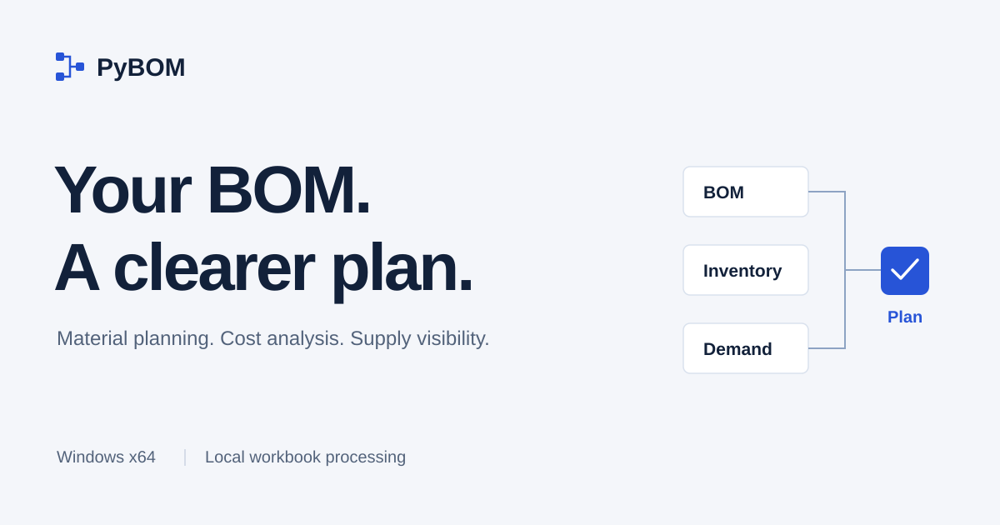

**[Product website](https://hey-yjenius.github.io/PyBOM/)** · **[Download for Windows](https://github.com/hey-yjenius/PyBOM/releases/latest/download/PyBOM-Windows-x64.zip)** · **[Getting started](GETTING_STARTED.md)**

Windows x64 · Portable ZIP · Local workbook processing

## A plan behind the parts

PyBOM connects your Excel BOM, inventory and dated demand to help you review what to buy, what to build and when to act.

- **Material planning:** requirements, dated receipts and suggested order actions.
- **Stock and cost:** shortages, days of supply, buildable quantities and multi-level cost rollups.
- **Review and follow-up:** supply risk, scenarios, Excel exports and a Manager Brief.

Missing inputs and assumptions stay visible. PyBOM provides advice; it does not place orders or write back to your ERP.

*Actual desktop app using fictional demonstration data. No company or customer records.*

## Start in three steps

1. **[Download the Windows ZIP](https://github.com/hey-yjenius/PyBOM/releases/latest/download/PyBOM-Windows-x64.zip)** and extract the entire folder.
2. **Open `PyBOM.exe`.** Keep `_internal` beside it. No Python installation is required.
3. **Open a workbook**, review the sheet and column mapping, then choose **Run all**.

The executable is not code-signed. Follow your organization's software approval process if Windows displays a warning.

## Try the examples

| Workbook | What is inside |
|---|---|
| **[English example](https://github.com/hey-yjenius/PyBOM/releases/latest/download/PyBOM-Example-EN.xlsx)** | 8 sheets, English instructions, all 54 column notes and neutral demo supplier names |
| **[한국어 예제](https://github.com/hey-yjenius/PyBOM/releases/latest/download/PyBOM-Example.xlsx)** | Korean instructions and column notes |

Both use fictional data with the same calculation inputs. The Windows ZIP includes the original Korean workbook; the English edition is a separate download.

## Guides and downloads

[Getting started](GETTING_STARTED.md) · [Data preparation guide](guides/DATA_PREPARATION.md) · [Release notes and checksums](https://github.com/hey-yjenius/PyBOM/releases/latest) · [Support](SUPPORT.md)

Application source is available as **`PyBOM-Source-1.0.0.zip`** in Releases. GitHub's automatic source archives contain this product website, not the application.

[License and third-party notices](NOTICES.md)
