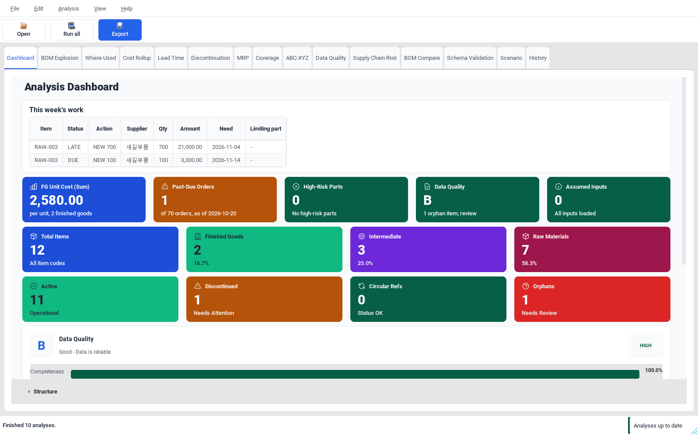
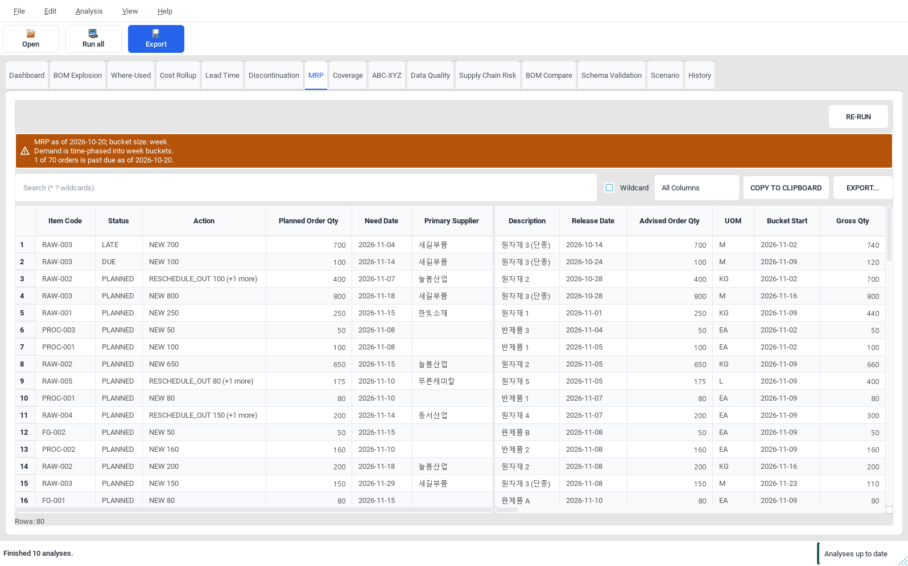
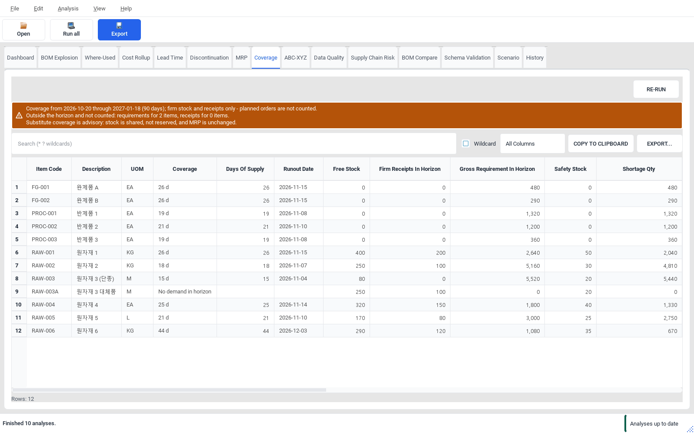

# PyBOM

### From an Excel BOM to a clearer purchase plan.

Material planning, cost analysis and supply risk — on your Windows PC.

**[Download for Windows](https://github.com/hey-yjenius/PyBOM/releases/latest/download/PyBOM-Windows-x64.zip)** · **[Getting started](GETTING_STARTED.md)** · **[Release notes](https://github.com/hey-yjenius/PyBOM/releases/latest)**

Windows x64 · Portable ZIP · No Python installation · Local file processing

 

## Know what needs attention

Bring your BOM, inventory and demand together. PyBOM helps you see what to buy, what to build and which shortages to address first.

| Your question | What PyBOM shows |
|---|---|
| What should we order, and when? | Material requirements, dated receipts and suggested order actions |
| Can we build it with current stock? | Buildable quantities and the parts that limit production |
| Where will inventory run short? | Days of supply, shortage dates and excess inventory |
| What does the assembly cost? | Multi-level cost rollups, with missing prices clearly identified |
| Which items need closer attention? | Supply risk, lead-time exposure and supplier follow-up |
| What if demand or supply changes? | Scenarios you can compare without changing the original input |

## Start with a workbook

1. **Download and extract** the Windows ZIP. Keep the entire `PyBOM` folder together.
2. **Open `PyBOM.exe`.** No Python setup or account is required.
3. **Open your workbook**, map its columns and choose **Run all**.
4. **Review and export** the results to Excel, or save a Manager Brief.

New to BOM analysis? Start with the included example workbook. It uses fictional data to demonstrate the input format.

**[Download example workbook](https://github.com/hey-yjenius/PyBOM/releases/latest/download/PyBOM-Example.xlsx)** · **[Read the data preparation guide](guides/DATA_PREPARATION.md)**

## See the plan, not just the data

*Review quantities, dates and suggested actions together.*

*See where committed supply falls short and where inventory is excessive.*

## Designed for local work

- **Your files stay on your PC.** Workbook processing does not require a cloud service.
- **Assumptions stay visible.** Missing prices, unknown demand and input conflicts are disclosed.
- **Your ERP stays in control.** PyBOM provides planning advice; it does not write changes back to your ERP.
- **Results are shareable.** Export analysis sheets and a concise Manager Brief for follow-up.

## Downloads and help

| Looking for | Go to |
|---|---|
| Windows application | [Download portable ZIP](https://github.com/hey-yjenius/PyBOM/releases/latest/download/PyBOM-Windows-x64.zip) |
| First-run instructions | [Getting started](GETTING_STARTED.md) |
| Input format and field explanations | [Data preparation guide](guides/DATA_PREPARATION.md) |
| Example Excel workbook | [Download example](https://github.com/hey-yjenius/PyBOM/releases/latest/download/PyBOM-Example.xlsx) |
| Changes, checksums and source | [Latest release](https://github.com/hey-yjenius/PyBOM/releases/latest) |
| Report a problem | [Support](SUPPORT.md) |

The Windows download is a portable application, not an installer. macOS and Linux application packages are not provided in this release.

---

PyBOM is a planning aid. Review recommendations against your operational constraints before placing orders or changing production plans.

[License and third-party notices](NOTICES.md)
